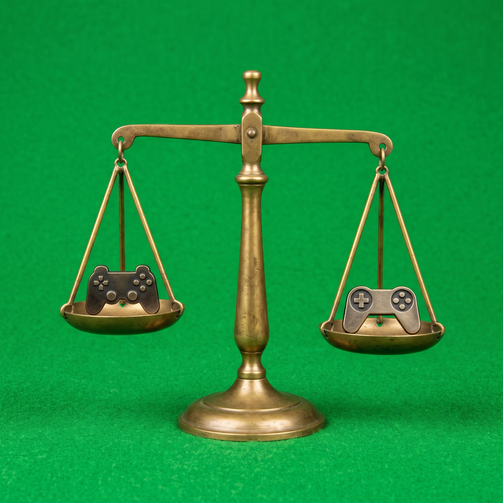

# Parallels-VMware-Gaming-Comparison

This repo holds one comparison, in Analysis.md. That file is the whole
substance here; this README only points at it.

> **Balance note:** the performance figures on this page and in Analysis.md are the analysis author claims. They were not retested here, and no benchmark or test was run for this re-skin.

Analysis.md compares Parallels Desktop and VMware Fusion for gaming on
Mac. Its verdict is that Parallels is the better choice for gaming, and
it puts the graphics-intensive performance gap at approximately 20 to
30 percent in Parallels' favour. Those figures, and the table claims
about optimization, ease of use, support, and updates, are the
Analysis.md author's claims. They were not re-benchmarked in this pass,
and no benchmark or test was run here.

The previous README title added the words "Combined with AtlasOS".
Nothing in Analysis.md discusses AtlasOS, so that phrase had no
supporting content in this repo and it is removed here. The title now
matches the repo name and the file it points to.
